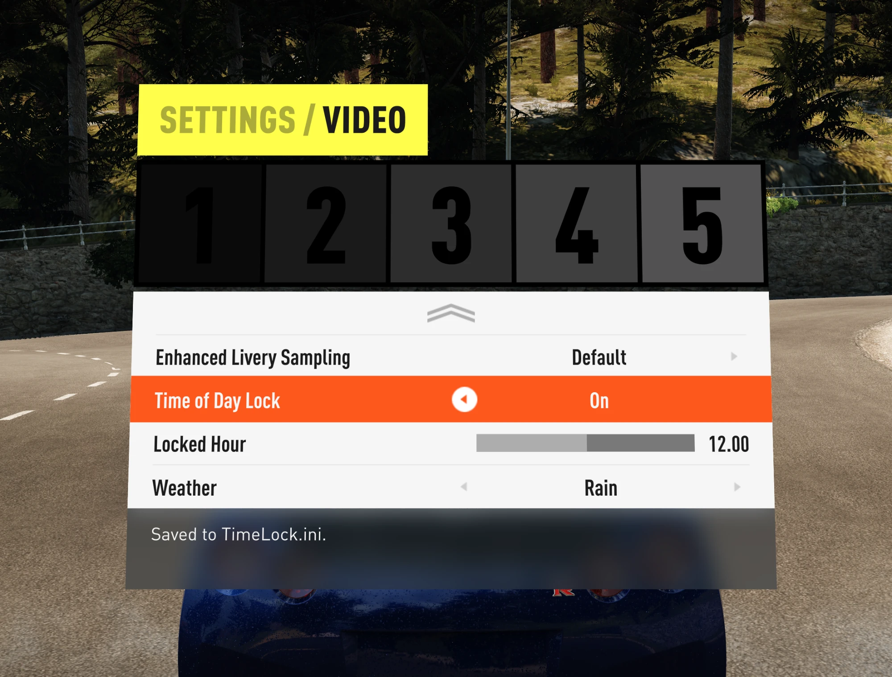

# Set Time & Weather FH2

An [Extra Options](https://github.com/RokkuDayo/ForzaHorizon2_ExtraOptions) plugin for Forza
Horizon 2 that lets you **lock the free-roam time of day** and **choose the free-roam weather**,
right from the game's own **Settings > Video** menu. Both are dynamic (the normal game) by
default, and your choices are remembered between sessions.

Everything happens in memory while the game runs. No game file is replaced or modified, every
patch checks the exact game bytes it expects first, and anything unexpected leaves the game stock
and writes a line to the log. Time and weather are set through the game's own functions (the same
ones its event flow uses), never by writing values into the world directly.



---

## Features

Three new rows in **Settings > Video**, after Brightness and Subtitles (and after any rows other
mods added):

| Row | Values | What it does |
|---|---|---|
| **Time of Day Lock** | Off / On | On: holds the free-roam clock at the Locked Hour. Off (default): the normal day/night cycle. |
| **Locked Hour** | 0 – 23.75, in quarter hours | The hour to hold (6 = dawn, 12 = noon, 17.75 = sunset, 23 = night; 18.5 = 18:30). Applies immediately while the lock is on. |
| **Weather** | Current / Sunny / Wet / Rain / Storm | Holds free-roam weather at one of the game's own weather options (the same list as the online event options). **Current** (default) keeps the game's normal weather cycle. |

- Changes apply right away and are saved to `TimeLock.ini`.
- **Races, car meets and events** that set their own time or weather keep it; free roam returns
  to your choice afterwards.
- A clock the game has stopped or locked itself (fixed-time events, cutscenes) is never touched.
- Weather options: **Sunny** is clear and dry, **Wet** is overcast with damp roads and no rain,
  **Rain** is rain with wet roads, **Storm** is heavy rain with a storm sky.

## Requirements

| Requirement | Version tested | Where to get it |
|---|---|---|
| **Forza Horizon 2** (Xbox One version) | Build **1.0.0.64** | Your own copy (you must own the game; nothing from it is included here) |
| **Azimuth** | **1.0.1** | [almost-there-games.itch.io/azimuth](https://almost-there-games.itch.io/azimuth) |
| **Forza Horizon 2 Extra Options** by RokkuDayo | **0.3.0** | [github.com/RokkuDayo/ForzaHorizon2_ExtraOptions](https://github.com/RokkuDayo/ForzaHorizon2_ExtraOptions) |

Tested on Windows 11 (64-bit). On a different game build Set Time & Weather checks the game code first and simply does nothing.

## Install

1. Install and set up **Azimuth 1.0.1** and **Extra Options 0.3.0** first, and check the game runs
   with Extra Options (there is an `FH2_ExtraOptions.log` beside `Azimuth.exe`).
2. Download **`FH2-SetTimeWeather-1.2.0.zip`** from this repository's **Releases** page and drag the **`mods`** folder inside it onto your Azimuth folder (the one with `azimuth.exe`). Say yes if Windows asks to merge folders. You get:

   ```
   <Azimuth folder>\mods\Set Time & Weather FH2\mod.json
   <Azimuth folder>\mods\Set Time & Weather FH2\TimeLock.ini
   <Azimuth folder>\mods\Set Time & Weather FH2\plugins\TimeLock.dll
   ```

3. That's it: Extra Options turns on any new mod folder it finds in `mods\` the next time the game starts, so you don't need to edit `loadorder.txt`. (It adds the mod at the end of your load order; move the `Set Time & Weather FH2` line if you want it elsewhere, and change it to `# Set Time & Weather FH2` to switch the mod off.)
4. Start the game.

## Usage

1. Open **Settings > Video** (from the pause menu or the main menu).
2. Scroll past Brightness and Subtitles to **Time of Day Lock**, **Locked Hour** and **Weather**.
3. Turn the lock on and pick an hour, and/or pick a weather. Back out to free roam: the clock and
   weather follow your settings.
4. To return to the normal game, set Time of Day Lock to **Off** and Weather to **Current**.

## Uninstall

1. Remove the `Set Time & Weather FH2` line from `mods\loadorder.txt`.
2. Delete `mods\Set Time & Weather FH2\`.

No game file was ever changed, and the next start is stock.

---

## Credits and legal

See [CREDITS.md](CREDITS.md). This project is not affiliated with or endorsed by Playground Games,
Turn 10 Studios, Microsoft, Almost There Games or the Extra Options author. **No game files are
included.** You need your own copy of Forza Horizon 2.

License: [GPL-3.0](LICENSE), the same licence as Extra Options, whose plugin API header `src\fh2_plugin.h` is included.

---

## AI use

This project was made with the help of AI (Claude by Anthropic). It was tested in game, but treat it as hobby software and keep backups of your saves.
